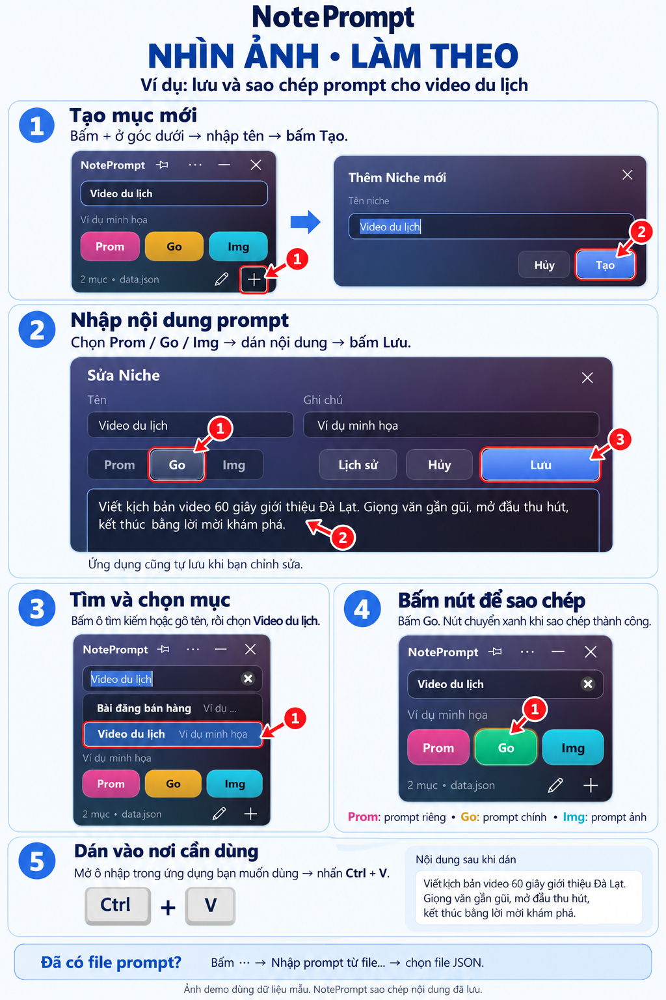

# NotePrompt

Ứng dụng Windows nhỏ gọn để lưu, sửa và copy nhanh prompt với ba nút Prom / Go / Img. Có tìm kiếm, ghi chú, tự lưu, lịch sử sửa, đổi tên/màu nút và ghim cửa sổ.

NotePrompt được phát triển từ AOPrompt thành dự án độc lập, có mã nguồn, tên ứng dụng, file thực thi và thư mục dữ liệu riêng. Không cần cài AOPrompt hoặc Auto Prompt.

## Tải về dùng ngay trên Windows

**[Tải NotePrompt.exe](https://github.com/gitsune181/NotePrompt/releases/latest/download/NotePrompt.exe)**, rồi mở file để dùng. Không cần cài Python hay thư viện.

Nút **Code → Download ZIP** tải mã nguồn dành cho người phát triển.

## Hướng dẫn bằng ảnh demo



[Mở ảnh hướng dẫn đầy đủ](assets/noteprompt-huong-dan-demo.png)

1. Bấm **+**, nhập tên mục rồi bấm **Tạo**.
2. Chọn tab **Prom / Go / Img**, dán nội dung rồi bấm **Lưu**. Ứng dụng cũng tự lưu khi chỉnh sửa.
3. Tìm và chọn mục cần dùng.
4. Bấm **Prom**, **Go** hoặc **Img** để sao chép; nút chuyển xanh khi thành công.
5. Đến nơi cần dùng và nhấn **Ctrl + V**.

Ba nút chỉ sao chép nội dung đã lưu. Ảnh hướng dẫn dùng dữ liệu mẫu.

## Dữ liệu riêng của mỗi người

- Lần đầu mở, ứng dụng tạo danh sách trống. Bấm **+** để thêm prompt.
- Chọn **⋯ → Nhập prompt từ file…** để nhập file JSON trên máy: hỗ trợ định dạng `niches.json` hoặc `data.json`. Mục trùng tên với mục đang có được bỏ qua; file nguồn không bị sửa.
- Đường dẫn nguồn do người dùng chọn được nhớ trong cài đặt cục bộ, không có đường dẫn cá nhân được cài sẵn.
- Mặc định lưu tại `%APPDATA%\NotePrompt`: `data.json` (prompt), `settings.json` (cài đặt và đường dẫn nguồn), `history.json` (lịch sử).
- Đổi thư mục ở **⋯ → Cài đặt → Chọn thư mục…**. Nếu có `data.json` cạnh file exe, app dùng thư mục đó.
- Ứng dụng không tự dùng dữ liệu hoặc cấu hình của AOPrompt. Nếu muốn chuyển dữ liệu, hãy chủ động nhập file.
- Các file dữ liệu cá nhân nằm trong `.gitignore`. Khi chia sẻ ZIP hoặc bản build, chỉ gửi mã nguồn sạch hoặc exe, không gửi thư mục dữ liệu. Thư mục đồng bộ đám mây do bạn chọn có thể được dịch vụ đó đồng bộ.

## Chạy từ mã nguồn

Cần Windows và Python 3.10 trở lên:

```powershell
python -m venv .venv
.venv\Scripts\python.exe -m pip install -r requirements.txt
.venv\Scripts\python.exe app.py
```

## Đóng gói

Chạy `build.bat` để tạo `dist\NotePrompt.exe`. Bản build chỉ chứa chương trình và icon; không đóng gói prompt, cấu hình hay đường dẫn cá nhân.
